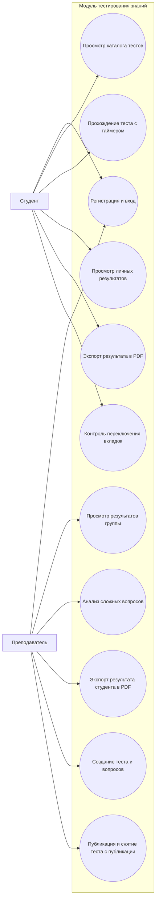
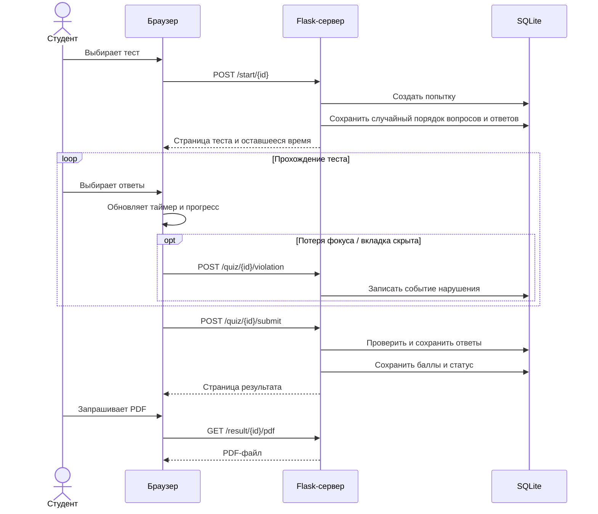
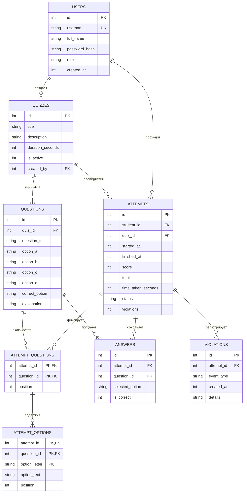

# Анализ и бизнес-логика проекта

## 1. Назначение

«Модуль тестирования знаний с таймером и сохранением результатов» предназначен для проведения учебных тестов. Студент выбирает тест, отвечает на вопросы в ограниченное время и получает результат. Преподаватель просматривает результаты студентов и анализирует вопросы, вызывающие наибольшие затруднения.

## 2. Роли пользователей

| Роль | Возможности |
|---|---|
| Студент | Регистрация, вход, просмотр тестов, прохождение тестов, история и PDF собственных результатов |
| Преподаватель | Создание и публикация тестов, просмотр результатов всех студентов, подробный разбор попыток, статистика сложных вопросов, экспорт PDF |

## 3. Основные бизнес-процессы

1. Пользователь проходит авторизацию. Незарегистрированный студент создаёт аккаунт.
2. Преподаватель создаёт тест: указывает название, описание, время, добавляет вопросы, четыре варианта ответа, правильный ответ и пояснение; затем публикует тест или сохраняет черновиком.
3. Студент выбирает опубликованный тест.
4. Сервер создаёт попытку, случайно перемешивает вопросы и варианты и сохраняет их порядок в базе.
5. Студент отвечает на вопросы. JavaScript отображает обратный отсчёт и состояние заполнения.
6. Система фиксирует уход со страницы, потерю фокуса окна и выход из полноэкранного режима. После трёх событий попытка закрывается со статусом нарушения.
7. При отправке или завершении времени сервер проверяет ответы, считает баллы и сохраняет результат.
8. Студент просматривает собственный результат и скачивает PDF.
9. Преподаватель просматривает результаты группы и статистику правильных/неправильных ответов по каждому вопросу.

## 4. UML-диаграмма вариантов использования

## 5. UML-диаграмма последовательности прохождения теста

## 6. ER-диаграмма базы данных

## 7. Статистика сложности

Сложность рассчитывается по доле правильных ответов на вопрос:
- менее 50% — сложный вопрос;
- от 50% до 74% — средняя сложность;
- 75% и выше — лёгкий вопрос.

Если ответов ещё нет, выводится статус «Пока нет данных».

## 8. Ограничение защиты от списывания

Браузер предоставляет события видимости страницы, потери фокуса и полноэкранного режима, но не даёт обычному сайту абсолютного запрета на переключение вкладок. В проекте используется обнаружение и журналирование этих событий, а также автоматическое завершение попытки после трёх нарушений.
